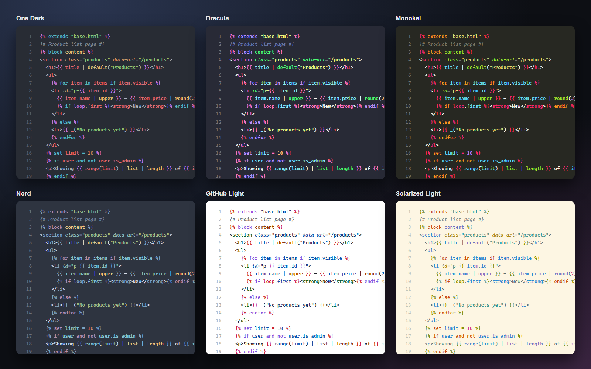
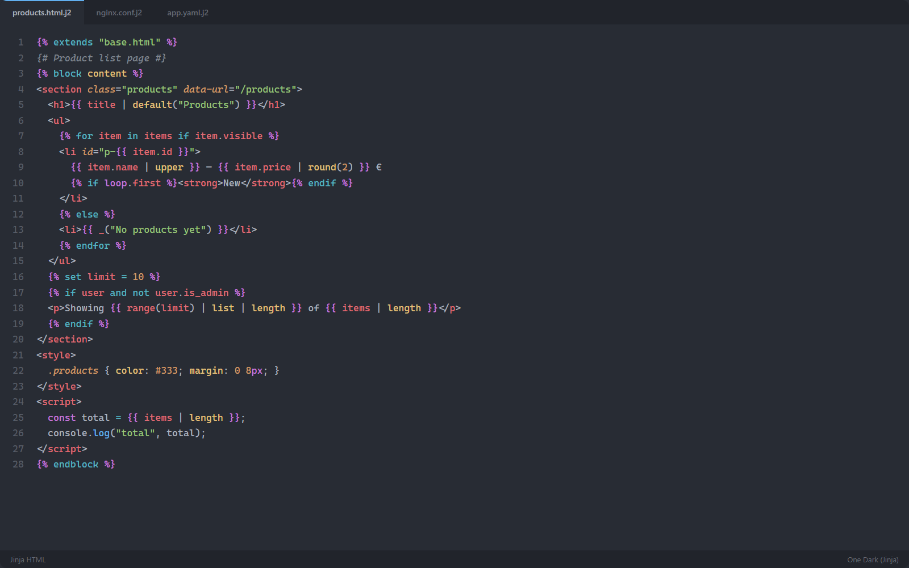
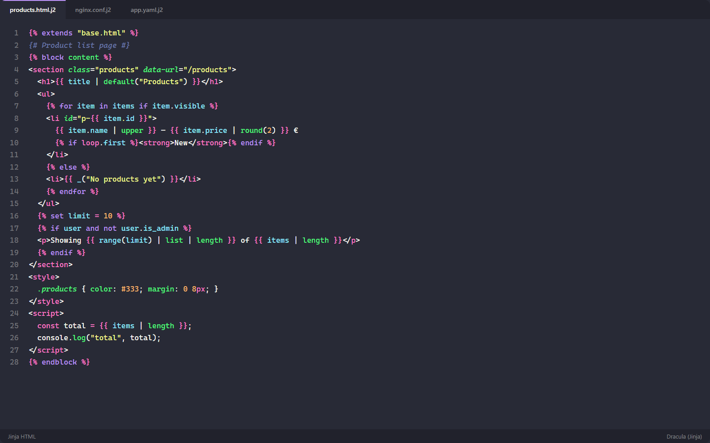
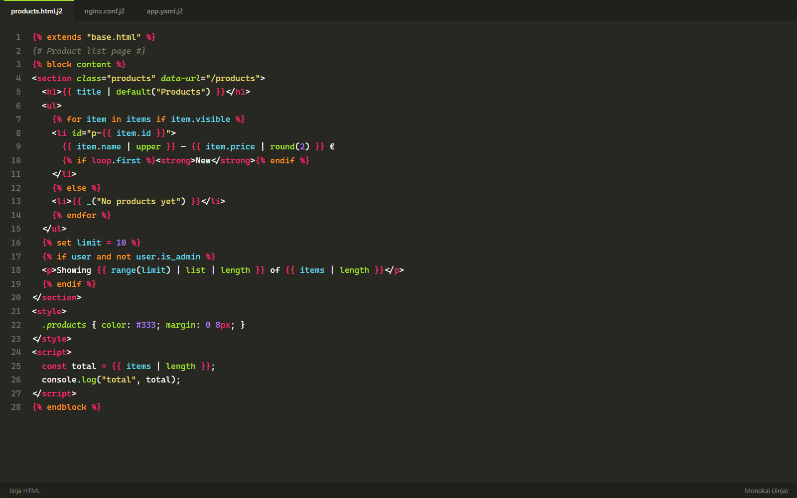
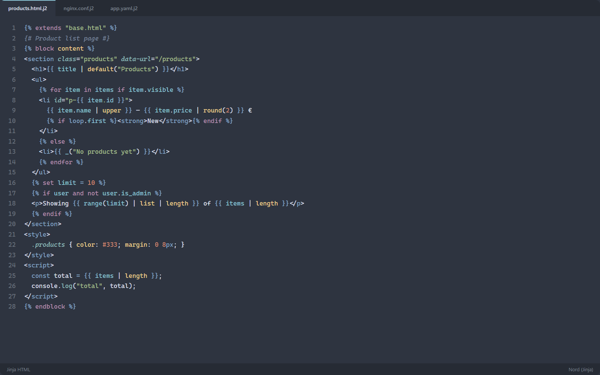
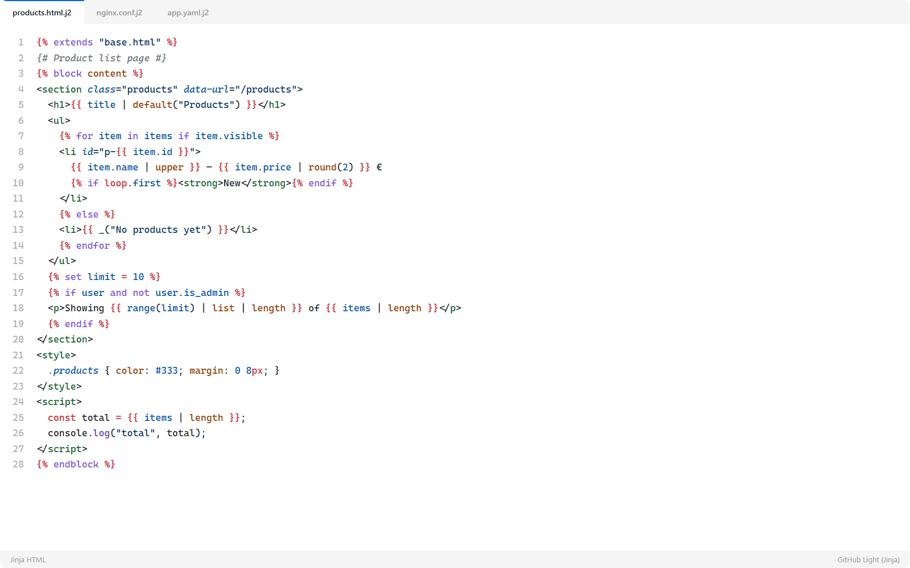
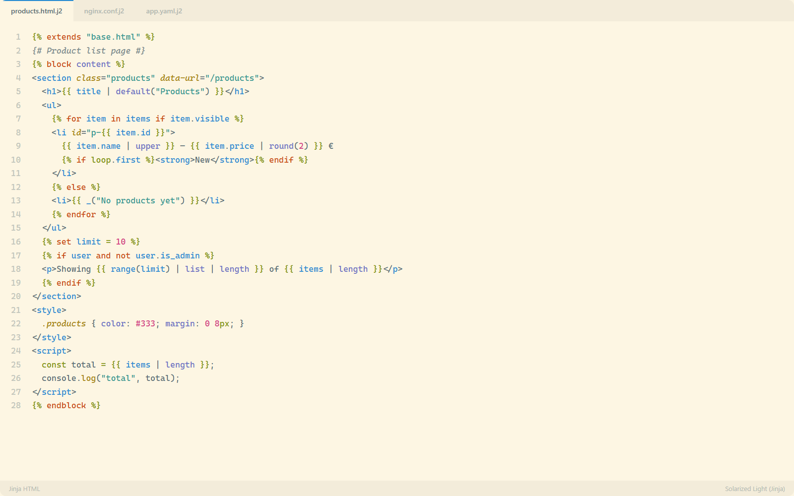

<p align="center">
  
</p>

<h1 align="center">Jinja Palettes for Orca</h1>

<p align="center">
  Six classic color palettes for <a href="https://github.com/stablyai/orca">Orca</a>, tuned so
  every part of a Jinja template stands out. Made to pair with
  <a href="https://github.com/alvarovegaromero/orca-jinja-syntax"><b>Jinja Syntax</b></a>.
</p>

---

## The palettes

| Palette                     | Mode  | `{{ }}` `` | `for` `if` | variables | filters |
| --------------------------- | ----- | --------------- | ---------- | --------- | ------- |
| **One Dark (Jinja)**        | dark  | purple          | cyan       | red       | gold    |
| **Dracula (Jinja)**         | dark  | pink            | purple     | cyan      | green   |
| **Monokai (Jinja)**         | dark  | magenta         | orange     | blue      | green   |
| **Nord (Jinja)**            | dark  | frost blue      | purple     | frost cyan | yellow |
| **GitHub Light (Jinja)**    | light | red             | purple     | blue      | brown   |
| **Solarized Light (Jinja)** | light | olive           | orange     | blue      | violet  |

Each palette also colors HTML, CSS, JavaScript, Python, YAML, Markdown and every other language
Orca highlights, so it works as an everyday theme too. Every color passes Orca's 3:1 contrast check
against its background, so none of them is dropped.

<p align="center">
  
  
  
  
  
  
</p>

## Install

In Orca, open **Settings → Plugins**, search for **Jinja Palettes** and click **Install**. Orca
switches to One Dark (Jinja) and GitHub Light (Jinja) right away and offers one click to undo it.

Or from a terminal:

```sh
orca plugin install alvarovegaromero/orca-jinja-palettes
```

Then pick a palette in **Settings → Appearance**:

- **Light theme / Dark theme** to color the whole app.
- **Light editor theme / Dark editor theme** to color only the code editor and keep the rest of
  Orca as it is.

## Make your own

Every palette is a short list of roles in [`scripts/palettes.mjs`](scripts/palettes.mjs):

```js
{
  id: 'my-palette',
  title: 'My Palette (Jinja)',
  base: 'dark',
  background: '#1e1e2e',
  foreground: '#cdd6f4',
  primary: '#89b4fa',
  primaryForeground: '#1e1e2e',
  colors: {
    delimiter: '#cba6f7', // {{ }} , and keywords such as const
    control: '#f5c2e7',   // for, if, endfor, in, and, not
    variable: '#89dceb',  // Jinja variables
    filter: '#a6e3a1',    // | upper, | default(...), is defined
    string: '#f9e2af',
    number: '#fab387',
    comment: '#7f849c',   // {# #}
    tag: '#89b4fa',       // HTML tags
    attribute: '#f9e2af', // HTML attributes
    function: '#89b4fa',
    operator: '#94e2d5',
    property: '#89dceb',  // CSS properties
    escape: '#f5c2e7',
    link: '#89b4fa',
    invalid: '#f38ba8'
  }
}
```

1. Fork this repository and add or edit a palette.
2. Run `node scripts/build-palettes.mjs`. It writes `themes/*.json`, lists them in
   `orca-plugin.json`, and nudges any color under 3:1 contrast toward the text color so Orca
   keeps it.
3. Run `orca plugin dev watch .` to see it live in Orca, and pick it in Settings → Appearance.

Orca reads the theme files directly, so you can also edit a `themes/*.json` by hand. Its
`tokenColors` use the same format as a VS Code theme.

## License

MIT. The palettes are adapted from open source themes; see [THIRD_PARTY.md](THIRD_PARTY.md).
